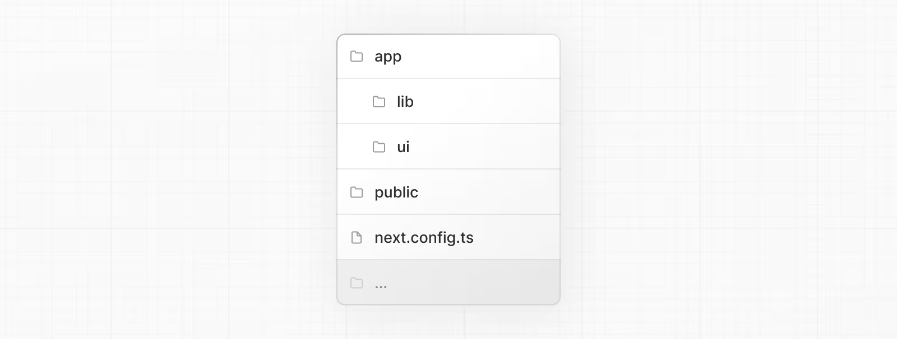
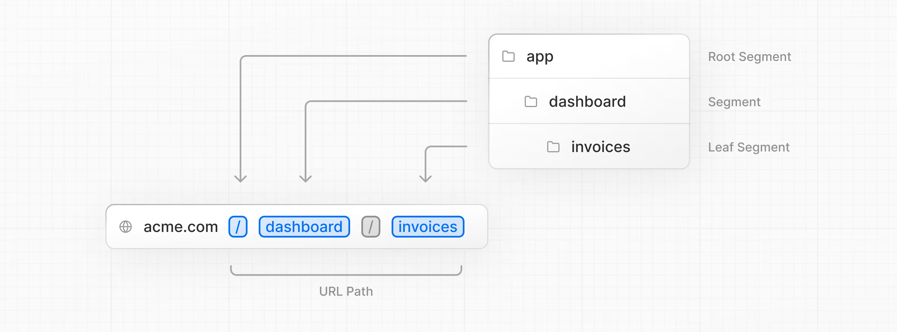
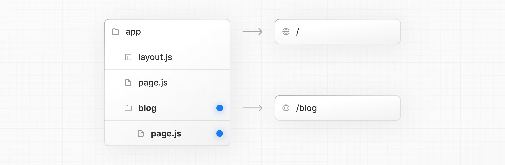
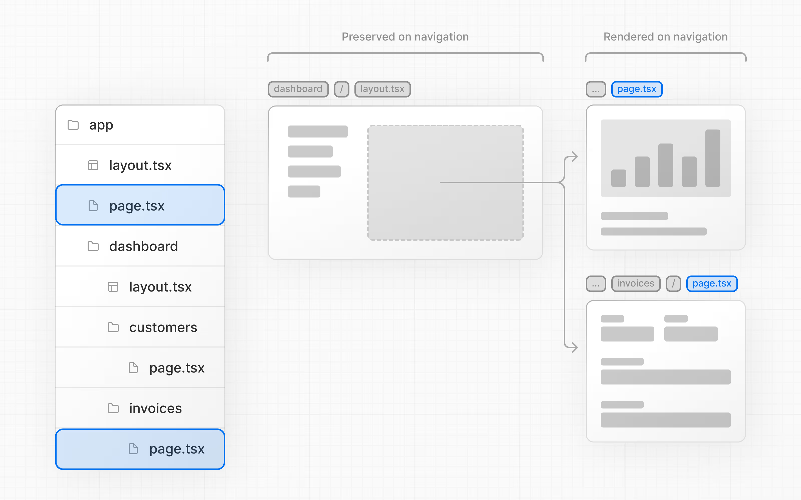

# Next.js Dashboard — Learning from Scratch

## Getting Started

Run the development server:

```bash
npm run dev
# or
yarn dev
# or
pnpm dev
# or
bun dev
```

Open [http://localhost:3000](http://localhost:3000) in your browser to see the result.

---

## Table of Contents

- [Chapter 1 — Project Structure](#chapter-1--project-structure)
- [Chapter 2 — CSS Styling](#chapter-2--css-styling)
- [Chapter 3 — Optimizing Fonts & Images](#chapter-3--optimizing-fonts--images)
- [Chapter 4 — Creating Layouts and Pages](#chapter-4--creating-layouts-and-pages)
- [Chapter 5 — Navigating Between Pages](#chapter-5--navigating-between-pages)

---

## Chapter 1 — Project Structure

### Folder Layout



| Path | Description |
|------|-------------|
| `/app` | All routes, components, and logic — this is where you'll work most |
| `/app/lib` | Reusable utility functions and data-fetching functions |
| `/app/ui` | UI components (cards, tables, forms) — pre-styled to save time |
| `/public` | Static assets such as images |
| `next.config.ts` | Root config file, created and pre-configured by `create-next-app` |

### Placeholder Data

Placeholder data lives in [`app/lib/placeholder-data.ts`](app/lib/placeholder-data.ts). Each JavaScript object represents a database table. For example, the invoices table:

```ts
const invoices = [
  {
    customer_id: customers[0].id,
    amount: 15795,
    status: 'pending',
    date: '2022-12-06',
  },
  {
    customer_id: customers[1].id,
    amount: 20348,
    status: 'pending',
    date: '2022-11-14',
  },
  // ...
];
```

### TypeScript

Most files use a `.ts` or `.tsx` extension — the project is written in TypeScript to reflect the modern web landscape.

Type definitions live in [`app/lib/definitions.ts`](app/lib/definitions.ts). For example:

```ts
export type Invoice = {
  id: string;
  customer_id: string;
  amount: number;
  date: string;
  // String union type — status can only be 'pending' or 'paid'
  status: 'pending' | 'paid';
};
```

TypeScript prevents accidentally passing the wrong data format — for example, a `string` where `amount` expects a `number`.

---

## Chapter 2 — CSS Styling

### Global Styles

Inside [`/app/ui/global.css`](app/ui/global.css) you can add CSS rules that apply to all routes — CSS resets, site-wide element styles, and more.

Import it once at the top-level component. In Next.js that is the root layout:

```ts
// app/layout.tsx
import '@/app/ui/global.css';
```

### Tailwind

Tailwind is a utility-first CSS framework that lets you style directly in JSX:

```tsx
<h1 className="text-blue-500">I'm blue!</h1>
```

### CSS Modules

CSS Modules scope styles to a single component by auto-generating unique class names, eliminating style collisions.

To try it, create `/app/ui/home.module.css` and import it in the component where you need it. Both approaches (Tailwind and CSS Modules) produce the same result — this course continues with Tailwind.

---

## Chapter 3 — Optimizing Fonts & Images

### Why Optimize Fonts?

Custom fonts can hurt performance if fetched at runtime. Next.js solves this with the `next/font` module — it downloads font files at **build time** and hosts them alongside your static assets, so there are zero extra network requests when a user visits the app.

### Why Optimize Images?

Next.js serves static assets from the top-level `/public` folder. A plain `` tag works, but has no built-in optimizations:

```html

```

### The `<Image>` Component

`<Image>` extends the native `` tag with automatic optimizations:

- Prevents layout shift while images load
- Resizes images to match the device viewport
- Lazy-loads images by default (loads when entering the viewport)
- Serves modern formats (WebP, AVIF) when the browser supports them

---

## Chapter 4 — Creating Layouts and Pages

### Nested Routing

Next.js uses **file-system routing** — folders map directly to URL segments.



Each route can have its own `layout.tsx` and `page.tsx`:



**Partial rendering** means only the `page.tsx` re-renders on navigation — the shared `layout.tsx` stays mounted, preserving client-side React state.



---

## Chapter 5 — Navigating Between Pages

In the previous chapter you created the dashboard layout and pages. Now let's add links so users can navigate between routes.

### Why Not `<a>` Tags?

The standard `<a>` element triggers a **full page refresh** on every navigation — even between pages that share the same layout. You can observe this in the sidebar if it currently uses `<a>` elements.

### The `<Link>` Component

Next.js provides `<Link />` for client-side navigation without a full reload. Replace `<a>` tags in [`/app/ui/dashboard/nav-links.tsx`](app/ui/dashboard/nav-links.tsx):

```tsx
import Link from 'next/link';

// before
<a href="/dashboard/invoices">Invoices</a>

// after
<Link href="/dashboard/invoices">Invoices</Link>
```

### Pattern: Active Link Highlighting

A common UI pattern is highlighting the link that matches the current page. Use the `usePathname()` hook from Next.js to read the current URL path:

```tsx
'use client';

import { usePathname } from 'next/navigation';

const pathname = usePathname();

<Link
  href={link.href}
  className={pathname === link.href ? 'bg-sky-100 text-blue-600' : ''}
>
  {link.name}
</Link>
```

> `usePathname()` is a React hook, so the component must be a **Client Component** — add `'use client'` at the top of `nav-links.tsx`.

Chapter 6

Setting Up Your Database
1- First push code in github
2- Create vercel account
3- from hoiby plan create new app 
4- imoprt github repostory 
5- Select repo for deployment
6- Configure project & deploy
7- Stroage sa new database propstgres select kra g
8- npm i -g vercel@latest
9- vercel link )it will auto creat .env.local from vercel and add token 
10 - option al if .env.local is not gemrated (vercel env pull .env.local) 
11- .env.local => .env replace 
12- .gitignore ma .env and vercel fodler add kr dain ga 


<!-- PRisma setup -->
pnpm install -D prisma
pnpm add @prisma/client
pnpm prisma init (initial basic sutrutcre )
update .env url in of db
npx prisma generate (will genearte prisma client isnide app fodler)
npx prisma push db (all schema into db) if already sync will show (The database is already in sync with the Prisma schema.)
npx prisma studio (will open replicate of datase schemo and will creat user or us)