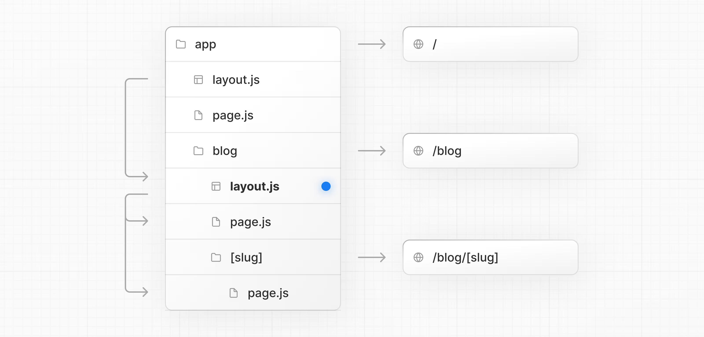

This is a [Next.js](https://nextjs.org) project bootstrapped with [`create-next-app`](https://nextjs.org/docs/app/api-reference/cli/create-next-app).

## Getting Started

First, run the development server:

```bash
npm run dev
# or
yarn dev
# or
pnpm dev
# or
bun dev
```

Open [http://localhost:3000](http://localhost:3000) with your browser to see the result.

Routing Files
Add page to expose a route, layout for shared UI such as header, nav, or footer, loading for skeletons, error for error boundaries, and route for APIs.

layout	.js .jsx .tsx	Layout
page	.js .jsx .tsx	Page
loading	.js .jsx .tsx	Loading UI
not-found	.js .jsx .tsx	Not found UI
error	.js .jsx .tsx	Error UI
global-error	.js .jsx .tsx	Global error UI
route	.js .ts	API endpoint
template	.js .jsx .tsx	Re-rendered layout
default	.js .jsx .tsx	Parallel route fallback page

Nested routes
Folders define URL segments. Nesting folders nests segments. Layouts at any level wrap their child segments. A route becomes public when a page or route file exists.

Path	URL pattern	Notes
app/layout.tsx	—	Root layout wraps all routes
app/blog/layout.tsx	—	Wraps /blog and descendants
app/page.tsx	/	Public route
app/blog/page.tsx	/blog	Public route
app/blog/authors/page.tsx	/blog/authors	Public route

Dynamic routes
Parameterize segments with square brackets. Use [segment] for a single param, [...segment] for catch‑all, and [[...segment]] for optional catch‑all. Access values via the params prop.

Path	URL pattern
app/blog/[slug]/page.tsx	/blog/my-first-post
app/shop/[...slug]/page.tsx	/shop/clothing, /shop/clothing/shirts
app/docs/[[...slug]]/page.tsx	/docs, /docs/layouts-and-pages, /docs/api-reference/use-router


Organizing your project
Next.js is unopinionated about how you organize and colocate your project files. But it does provide several features to help you organize your project.

Component hierarchy
The components defined in special files are rendered in a specific hierarchy:

layout.js
template.js
error.js (React error boundary)
loading.js (React suspense boundary)
not-found.js (React error boundary for "not found" UI)
page.js or nested layout.js


The components are rendered recursively in nested routes, meaning the components of a route segment will be nested inside the components of its parent segment.


Layouts and Pages
Creating a page
A page is UI that is rendered on a specific route. To create a page, add a page file inside the app directory and default export a React component. For example, to create an index page (/):

app/page.tsx
export default function Page() {
  return <h1>Hello Next.js!</h1>
}

Creating a layout
A layout is UI that is shared between multiple pages. On navigation, layouts preserve state, remain interactive, and do not rerender.

You can define a layout by default exporting a React component from a layout file. The component should accept a children prop which can be a page or another layout.

For example, to create a layout that accepts your index page as child, add a layout file inside the app directory:
export default function DashboardLayout({
  children,
}: {
  children: React.ReactNode
}) {
  return (
    <html lang="en">
      <body>
        {/* Layout UI */}
        {/* Place children where you want to render a page or nested layout */}
        <main>{children}</main>
      </body>
    </html>
  )
}

Creating a nested route

A nested route is a route composed of multiple URL segments. For example, the /blog/[slug] route is composed of three segments:

/ (Root Segment)
blog (Segment)
[slug] (Leaf Segment)

Folders are used to define the route segments that map to URL segments.
Files (like page and layout) are used to create UI that is shown for a segment.


app/blog/page.tsx
// Dummy imports
import { getPosts } from '@/lib/posts'
import { Post } from '@/ui/post'
 
export default async function Page() {
  const posts = await getPosts()
 
  return (
    <ul>
      {posts.map((post) => (
        <Post key={post.id} post={post} />
      ))}
    </ul>
  )
}


Nesting layouts

By default, layouts in the folder hierarchy are also nested, which means they wrap child layouts via their children prop. You can nest layouts by adding layout inside specific route segments (folders).

For example, to create a layout for the /blog route, add a new layout file inside the blog folder.



Creating a dynamic segment
app/blog/[slug]/page.tsx


Rendering with search params
In a Server Component page, you can access search parameters using the searchParams prop:

app/page.tsx

export default async function Page({
  searchParams,
}: {
  searchParams: Promise<{ [key: string]: string | string[] | undefined }>
}) {
  const filters = (await searchParams).filters
}


Linking between pages

You can use the <Link> component to navigate between routes. <Link> is a built-in Next.js component that extends the HTML <a> tag to provide prefetching and client-side navigation.

For example, to generate a list of blog posts, import <Link> from next/link and pass a href prop to the component:

app/ui/post.tsx

import Link from 'next/link'
 
export default async function Post({ post }) {
  const posts = await getPosts()
 
  return (
    <ul>
      {posts.map((post) => (
        <li key={post.slug}>
          <Link href={`/blog/${post.slug}`}>{post.title}</Link>
        </li>
      ))}
    </ul>
  )
}
